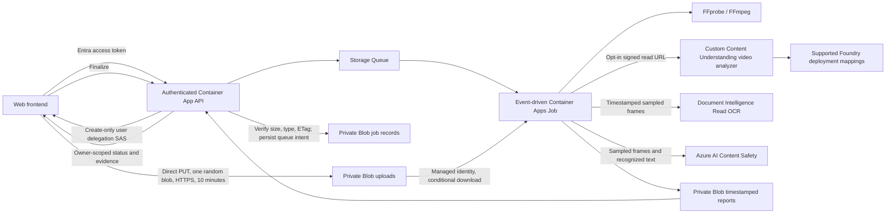

# VideoExtration architecture

VideoExtration is an evidence-first campaign-video review sample, not a publishing
approval authority. The exact project spelling is intentional.

## Two execution modes

Local mode uses a shared local SQLite database and private local files. A separate
worker process polls queued jobs. It performs actual technical media analysis.
Without Azure AI configuration, semantic, OCR, and safety checks remain
`not-evaluated`; they are not simulated.

Azure mode uses private Blob containers (`uploads`, `jobs`, `reports`), Storage
Queue (`analysis` and `analysis-poison`), a public authenticated API, and an
event-driven Container Apps Job using the same container image with a different
entry point. Job records and reports do not depend on ephemeral container disks.
No agent framework, vector database, or Video Indexer dependency is needed.

## Trust boundaries

- The Azure API validates single-tenant Entra v2 access tokens: signature,
  issuer, audience, expiry, required claims, and delegated `Video.Analyze` scope.
  Configure the API app registration to issue v2 access tokens. An ID token is
  not an API access token.
- Job/report access is owner scoped using tenant ID and object ID. Random job IDs
  are not authorization.
- API and worker use a user-assigned managed identity. No storage account keys,
  AI keys, or client secrets are required. Local development bearer authentication
  is intentionally separate and forbidden in Azure mode.
- A browser gets a create-only SAS for one random blob, never container access,
  list/read/delete permission, or server credentials. It expires after ten
  minutes and requires HTTPS. The browser includes `If-None-Match: *`.
- **A SAS does not enforce upload length.** Finalization checks declared length,
  actual length, and MIME type. The worker independently validates actual media
  and conditionally downloads the recorded ETag. Content type is not proof of
  format. Expired/rejected/orphaned uploads are subject to storage lifecycle
  cleanup. Use a fronting upload proxy if a hard pre-ingress byte limit is
  required for an untrusted multi-tenant production service.
- Queue delivery is at least once. Blob record leases serialize finalization
  and processing; completed/failed jobs are not analyzed again. A persisted
  `queue-pending` outbox intent makes a failed enqueue visible and repairable
  by retrying finalization.
- Remote operation polling only follows HTTPS URLs on the configured service
  origin. SAS URLs and bearer tokens must never be logged. Evidence may contain
  campaign information, recognized text, and transcripts; restrict report access.

## Evidence and conclusions

Reports retain actual FFprobe/FFmpeg evidence and service output separately from
deterministic rule conclusions. Custom campaign fields (brand, offer, CTA, summary)
are **generated interpretations**, even when accompanied by source/confidence.
They are not proof that legally required text was shown.

Rules use explicit versions and `pass`, `fail`, `needs-review`,
`not-evaluated` states. Technical pass only means the sample's measurable rule
was satisfied. The included portrait placement profile is **illustrative**:
it is not a verified, current official requirement of any social-media platform.
Review and version the profile against the actual placement specification before
using it operationally.

Read OCR is performed on bounded, timestamped frames. A recognized match means
only "observed in this sample"; a missing match does not prove absence from the
video. This sample does not certify minimum display duration, safe-area placement,
contrast, every-frame legibility, or complete language coverage.

Content Safety uses four documented categories (Hate, SelfHarm, Sexual,
Violence). A configurable policy would be appropriate for production; this
sample illustrates a severity threshold of four. Even all-zero returned
severities do not clear unsampled content or establish advertiser suitability.
Transcript safety consumes recognized transcript phrases, not AI-generated
summaries. Missing transcripts, truncated text, failed OCR, and skipped calls
remain visible.

No report guarantees platform acceptance, music rights, copyright ownership,
licensing, disclosure compliance, legal clearance, or campaign claims accuracy.
Human review is mandatory.

## Bounded processing and production gaps

Uploads, duration, resolution, sampled-frame count, subprocess time, remote
responses, polling, text length, job execution duration, parallel jobs, and retries
are bounded. Process media as untrusted input. Run the container without root,
keep FFmpeg patched, and add network egress controls/sandboxing for hostile media
in production.

This sample uses public Azure endpoints protected by Entra/RBAC or SAS; **private
Blob containers are not private network endpoints**. A production rollout needs
an approved networking/data-residency design, malware scanning/quarantine,
tenant-level quotas/rate limits, spend controls, lifecycle/retention review,
operational alerting, and an automatic outbox reconciler. The sample provides
repair-by-retry rather than claiming distributed exactly-once transactions.

## Official contracts used

Reviewed 2026-10-20; live service calls were not made.

- [Content Understanding REST quickstart, GA 2025-11-01](https://learn.microsoft.com/en-us/azure/ai-services/content-understanding/quickstart/use-rest-api)
- [Create/replace custom analyzers](https://learn.microsoft.com/en-us/rest/api/contentunderstanding/content-analyzers/create-or-replace?view=rest-contentunderstanding-2025-11-01)
- [Model mappings and per-analyzer supportedModels](https://learn.microsoft.com/en-us/azure/ai-services/content-understanding/concepts/models-deployments)
- [Video limits and supported models](https://learn.microsoft.com/en-us/azure/ai-services/content-understanding/service-limits)
- [Video sampling/transcription limitations](https://learn.microsoft.com/en-us/azure/ai-services/content-understanding/video/overview)
- [Read OCR, 2024-11-30](https://learn.microsoft.com/en-us/azure/ai-services/document-intelligence/prebuilt/read)
- [Content Safety image, 2024-09-01](https://learn.microsoft.com/en-us/rest/api/contentsafety/image-operations/analyze-image?view=rest-contentsafety-2024-09-01)
- [Content Safety text, 2024-09-01](https://learn.microsoft.com/en-us/rest/api/contentsafety/text-operations/analyze-text?view=rest-contentsafety-2024-09-01)

Use the GA Content Understanding API by default. The newer
`2026-06-01-preview` API is preview and is not required by this sample.
